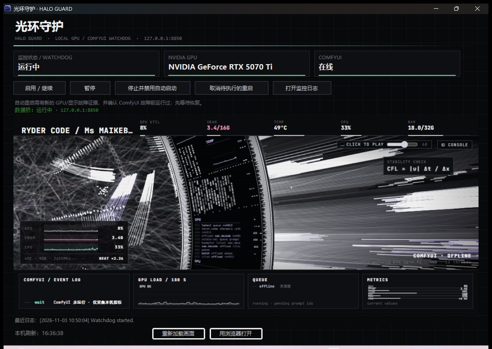

# 光环守护 · HaloGuard

Windows 本地 NVIDIA GPU 与 ComfyUI 监管工具。后台 PowerShell 看门狗静默轮询，桌面程序负责一个看得懂的界面——上面是监管状态，下面是随负载跳动的光环画面。



## 它做什么

- **看门狗**：`nvidia-smi` 连续失败，或系统日志出现明确的 CUDA 设备丢失、sticky error、显示驱动重置，并且确认 ComfyUI 在故障前正在运行、恢复等待后仍未恢复，才会安排 Windows 重启。
- **实时监控**：内嵌 WebView2 显示光环画面，把 GPU 利用率、显存、温度、功耗、CPU、内存和 ComfyUI 队列画在环上；**节拍随负载变快**，GPU 瞬升会补一拍，任务结束连打两拍。
- **数据全部真实**：顶部 KPI、环形卡片、底部四块面板都接 `nvidia-smi` 和 ComfyUI 的 HTTP 接口，没有随机数。

## 界面

- **三张状态卡**：监控状态 / NVIDIA GPU / COMFYUI，底部色条绿=正常、橙=警告、红=异常
- **中间光环**：点击画面获得焦点后，`F` 全屏、`C` 打开调参面板（56 个参数）、`M` 音乐、`T` 关闭「节拍跟随负载」
- **底部四块面板**：事件流、GPU 负载曲线（180 秒）、队列、当前指标
- 日志压成窗口底部一行，点「打开监控日志」看全文

## 使用

1. 双击 `Install.bat`：创建登录启动项和桌面快捷方式，并启动后台监控。
2. 双击桌面上的**光环守护**打开监管界面。
3. 关闭窗口右上角的 ✕ 只关闭界面，后台监控继续。
4. 界面按钮可以启用/继续、暂停、停止监控，或取消待执行的 Windows 重启。

「停止并禁用自动启动」会停止当前监控，并让登录启动项以后保持停用；再按「启用/继续」可恢复。

## 重启判定

- `nvidia-smi` 连续失败，或近期日志 / Windows 系统事件出现明确的 CUDA 设备丢失、sticky error 或显示驱动重置证据后，进入恢复等待。
- 只有 ComfyUI 在故障发生前处于运行状态，且经过恢复等待仍未恢复，才会安排系统重启。
- 单独的 ComfyUI 未运行、端口未监听、普通工作流错误、WARNING 或显存不足**不会**触发重启。
- 监控事件写入 ComfyUI 根目录下的 `logs/gpu_comfy_watch.log`；正常轮询不写逐分钟状态。

默认 ComfyUI 根目录是 `D:\ComfyUI\ComfyUI`。安装位置不同时，设置用户环境变量 `COMFYUI_ROOT`，然后重新登录。

## 数据从哪来

`haloflux\bridge.py`，纯标准库，无第三方依赖，只监听 `127.0.0.1:8850`：

| 指标 | 来源 | 频率 |
|---|---|---|
| GPU 利用率 / 显存 / 温度 / 功耗 / 风扇 / 频率 | `nvidia-smi --query-gpu=...` | 1 秒 |
| CPU | `kernel32!GetSystemTimes` 差分（ctypes） | 1 秒 |
| 内存 | `kernel32!GlobalMemoryStatusEx`（ctypes） | 1 秒 |
| 占用 GPU 的进程 | `nvidia-smi --query-compute-apps` | 3 秒 |
| ComfyUI 队列 / 历史任务 / 显存 | `/queue`、`/history`、`/system_stats` | 2 秒 |

`GET /api/stats` 返回当前值 + 最近 180 个采样（`hist`），曲线由服务端攒，刷新页面不丢。

## 依赖

| 依赖 | 说明 |
|---|---|
| .NET Framework 4.8 | Windows 自带 |
| Microsoft Edge WebView2 Runtime | Win10/11 一般已装；缺失时窗口内会提示，可点「用浏览器打开」兜底 |
| Python 3 | PATH 里找，或 `C:\Python314\python.exe` 等固定位置 |
| `WebView2Loader.dll` 等 3 个 DLL | 必须和 EXE 同目录（仓库已附带） |

## 构建

在 Windows PowerShell 运行：

    .\build.ps1

使用系统自带的 .NET Framework C# 编译器（`csc.exe`）生成 `HaloGuard.exe`，并把 `app.ico` 嵌成程序图标。编译需要同目录的 WebView2 DLL 与 `app.ico`。

## 目录

```
HaloGuard.exe                  主程序（WinForms + WebView2）
gpu_comfy_watch_panel.cs       界面与内嵌浏览器
build.ps1                      编译脚本
install.ps1 / Install.bat      安装快捷方式与登录启动项
gpu_comfy_watch.ps1            后台看门狗
app.ico                        程序图标
haloflux\bridge.py             数据桥（nvidia-smi / ComfyUI → HTTP）
haloflux\site\                 HALOFLUX 画面（已接真实数据）
docs\screenshot.jpg            README 截图
WebView2*.dll                  内嵌浏览器运行库
*.orig                         改版前的备份（回退用，可删）
```

## 许可证

`haloflux\` 目录里的页面与素材来自 [HALOFLUX](https://github.com/Ryder191/haloflux)，按 **PolyForm Noncommercial 1.0.0** 授权，版权归 Ryder191（RYDER CODE / Ms MAIKEBAIs CAT），**仅限非商业使用**；转载或二次创作须保留署名与来源链接。

`bridge.py`、界面改动与其余代码不属于该授权范围。
